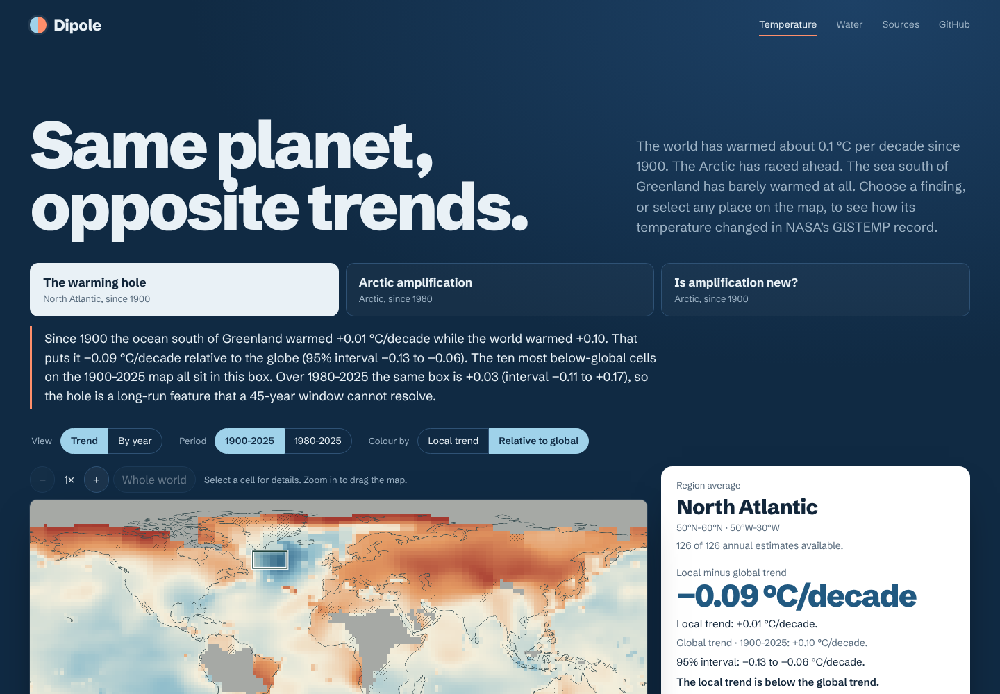

<h1 align="center">Dipole</h1>

<b>Same planet, opposite trends.</b> See how any place on Earth warmed compared with the world, using NASA data.

**[Open Dipole](https://ompatnaik.com/Dipole/)**. It runs in the browser, with no account or download.

## What you can explore

- **Three findings.** Since 1900, the sea south of Greenland has barely warmed (+0.01 °C per decade, against +0.10 for the world). Since 1980, the Arctic has warmed 3.3 times faster than the world. Over the full century, most of that Arctic gap disappears.
- **Any place.** Select a 2° map cell to see its temperature history and how its trend compares with the global one.
- **People.** Estimated 2020 population living where warming outpaced the global average.
- **Water.** [Northwest India’s water storage](https://ompatnaik.com/Dipole/water/) after each monsoon, from NASA’s GRACE satellites.

## Learn more

- [Temperature methods, results and how to reproduce them](docs/temperature.md)
- [Water storage methods](docs/water/method.md)
- [Data sources and AI use](docs/sources.md)

Built by Om Patnaik and [Vihaan Vajpeyi](https://github.com/vihaanvajpeyi) for the 2026 NASA Space Apps Challenge, [Be An Earth System Trend Detective!](https://www.spaceappschallenge.org/2026/challenges/earth-system-trend-detective/)
