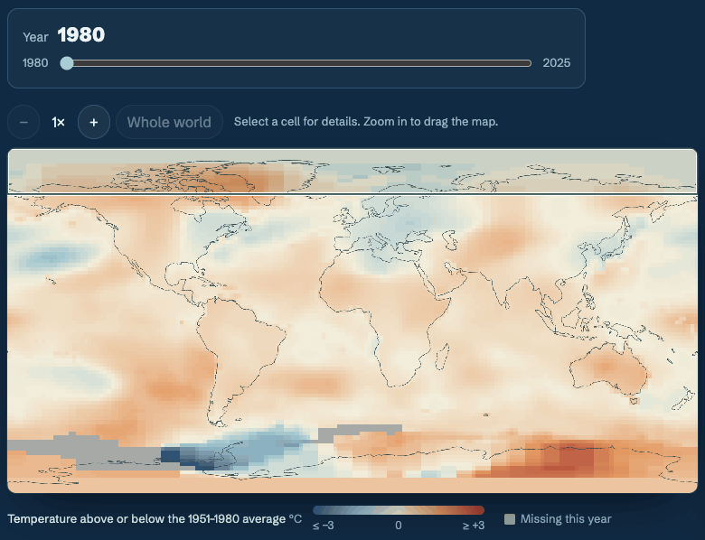

<h1 align="center">Dipole</h1>

By Om Patnaik and <a href="https://github.com/vihaanvajpeyi">Vihaan Vajpeyi</a>

<b>Use NASA temperature records to see how fast a place warmed compared with the world.</b>

**[Open Dipole](https://ompatnaik.com/Dipole/)**, choose **By year**, and drag the slider to compare years. The explorer runs in your browser without an account or download.

Each frame shows one year. Red means warmer than that location’s 1951–1980 average and blue means cooler. The outline marks the Arctic.

## What you can explore

- **Three findings.** Since 1900, the sea south of Greenland has barely warmed (+0.01 °C per decade, against +0.10 for the world). The Arctic warmed at 3.3 times the global rate over 1980–2025 and 1.6 times the global rate over its longer continuous record, 1921–2025.
- **Any place.** Select a 2° map cell to see its temperature history and how its trend compares with the global one.
- **People.** Estimated 2020 population living where warming outpaced the global average.
- **Water.** [Northwest India’s water storage](https://ompatnaik.com/Dipole/water/) after each monsoon, from NASA’s GRACE satellites.

## Learn more

- [Temperature methods, results and how to reproduce them](docs/temperature.md)
- [Water storage methods](docs/water/method.md)
- [Data sources and AI use](docs/sources.md)

Built for the 2026 NASA Space Apps Challenge, [Be An Earth System Trend Detective!](https://www.spaceappschallenge.org/2026/challenges/earth-system-trend-detective/)
