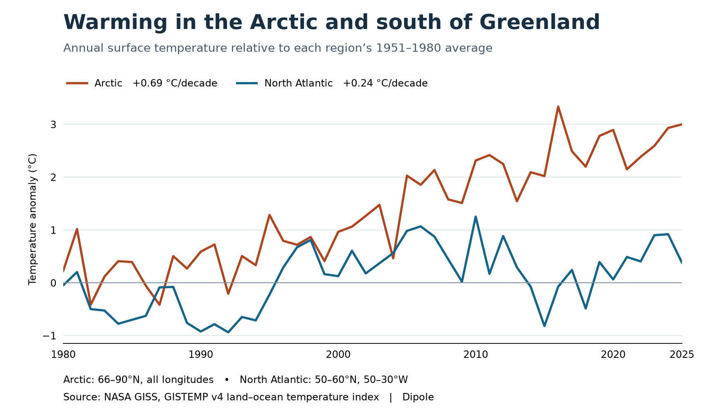

# The Arctic and the ocean south of Greenland, 1980–2025

The Arctic warmed by 0.69°C per decade. The North Atlantic box warmed by 0.24°C per decade. The paired annual record puts the difference at 0.45°C per decade, with a 95% confidence interval of 0.29 to 0.61°C per decade.



## How to read the lines

Zero is the 1951–1980 reference for each region. Each point represents one calendar year. For example, in 2015 the Arctic was 2.02°C above its reference and the Atlantic box was 0.82°C below its own. That cold Atlantic year sits within an overall warming trend for this box and period.

| Region or comparison | Temperature trend (°C per decade) | 95% interval |
| --- | ---: | ---: |
| Arctic | +0.69 | +0.59 to +0.79 |
| North Atlantic box | +0.24 | +0.09 to +0.38 |
| Arctic minus North Atlantic box | +0.45 | +0.29 to +0.61 |

## Region and data choices

The Arctic cap spans 66–90°N across all longitudes. The 66°N edge of NASA’s grid is close to the Arctic Circle at about 66.5°N. The cap includes both land and ocean. [NSIDC Arctic definitions](https://nsidc.org/learn/parts-cryosphere/arctic-weather-and-climate)

The North Atlantic box spans 50–60°N and 50–30°W. We chose this offshore area south of Greenland before reading the trends. It covers 50 grid cells and represents a specific part of the basin. Research on the subpolar Atlantic gives context for asking how surface temperatures evolve there. Differences in region, season or study period can change the result. [Seasonal changes in the North Atlantic cold anomaly](https://doi.org/10.1029/2019JC015379)

We used NASA’s GISTEMP v4 Land–Ocean Temperature Index on its 2° grid with 1,200 km smoothing. It combines air temperatures over land with sea surface temperatures over open water. The grid already contains monthly anomalies relative to 1951–1980. The November 10, 2026 source file was accessed on November 14, 2026. [GISTEMP Team, NASA GISS](https://data.giss.nasa.gov/gistemp/) · [Lenssen et al., 2024](https://doi.org/10.1029/2023JD040179)

## Calculation and uncertainty

Each monthly average weights valid cells by area using the cosine of latitude. This matters in the Arctic, where the grid cells get narrower toward the pole. We required values for at least 80% of each region’s area in every month and all 12 months in a year. All 552 months passed in both regions. Complete grid coverage includes NASA’s estimates between measurements. [NASA’s explanation of the grid](https://data.giss.nasa.gov/gistemp/faq/)

We fitted a straight line to each series and to their difference in the same 46 years. The intervals use Newey–West standard errors with three annual lags, a finite-sample correction and a t critical value. They describe uncertainty in the fitted linear rates conditional on this GISTEMP series. They exclude additional uncertainty in the underlying NASA temperature estimates. Establishing the physical cause would require other evidence.

## Reproduce the chart

From the repository root, use Python 3.11. The first two commands install the recorded analysis environment. The download is about 25 MB.

```sh
python3.11 -m venv .venv
.venv/bin/python -m pip install -r analysis/requirements.txt
mkdir -p raw
curl -fL --retry 3 -o raw/gistemp.nc.gz https://data.giss.nasa.gov/pub/gistemp/gistemp1200_GHCNv4_ERSSTv5.nc.gz
shasum -a 256 raw/gistemp.nc.gz
gzip -dc raw/gistemp.nc.gz > raw/gistemp.nc
.venv/bin/python analysis/temperature.py
.venv/bin/python analysis/check_temperature.py
```

The SHA-256 of the compressed NASA file for this chart is `f7788db9044d0f0e3f9561ad5d0fd82e59cdfdb82ea8a10244f78f2cb032a3c7`. NASA updates the file monthly and may revise earlier estimates. The exact downloaded file is retained in the project’s local raw data folder.

The second script reads the packed temperature values with a separate NetCDF reader, calculates the area of each latitude band from its edges, and checks the exported means and slopes. A known rise of 0.30°C per decade checks the time and unit conversion.

[Annual data and coverage](../results/annual-temperatures.csv) · [Trend estimates and confidence intervals](../results/trends.csv)

## Explore a grid cell

[Open the temperature map](https://ompatnaik.com/Dipole/). Click the map, move with the arrow keys, or enter coordinates. The marker and outlined box identify the selected cell. The Chennai preset selects the coastal grid cell containing the city. Each location covers two degrees in both latitude and longitude.

Of 16,200 cells, 15,805 have all 46 complete calendar years. The map reports a rate for these cells using the same trend fit as the regional analysis. Multiplying the rate and its interval by 4.5 gives the **fitted** change over the 45 years between 1980 and 2025. These pointwise intervals describe the selected cell. The map color shows rate alone. At cells with gaps the chart and table show the available complete years.

### Comparing two periods with the global record

The explorer also covers 1900–2025. In each view, the relative trend is the fitted slope of the annual local anomaly minus the annual global anomaly. Its interval uses the same fit on that difference. The history chart shows both original annual series and the local fitted line.

For the longer period, 11,794 cells have complete histories. The North Atlantic region meets the coverage rule in all 126 years. The Arctic meets it in 111 years. Its last gap is 1920, so the Arctic trend and its global reference both use the continuous record from 1921 through 2025. The chart retains the earlier annual values that meet the coverage rule.

To rebuild the explorer, download the NASA global table in addition to the grid above. The global table snapshot used here has SHA-256 `a7b1939db2e7e484c798e925e0f07f8184356c52ac0e7ce264adcd0f25e81253`.

```sh
curl -fL --retry 2 'https://data.giss.nasa.gov/gistemp/tabledata_v4/GLB.Ts+dSST.csv' -o raw/global.csv
.venv/bin/python analysis/export_map.py
.venv/bin/python analysis/check_map.py
.venv/bin/python analysis/station_coverage.py
.venv/bin/python analysis/check_coverage.py
python3 -m http.server 8765 --bind 127.0.0.1 --directory docs
```

### Hatched cells

NASA's standard grid fills cells from stations up to 1,200 km away. The map hatches land cells where NASA's 250 km grid has data in fewer than half the months of the selected period: 850 of 5,392 land cells for 1980–2025 and 1,049 for 1900–2025. A cell counts as land when its centre lies inside the Natural Earth outline. Ocean cells are not hatched. The saved monthly coverage is in `analysis/station_support_250km.json`, and `check_coverage.py` confirms the map files match it. To recompute it, download the 250 km grid to `raw/gistemp250.nc` before running `station_coverage.py`:

```sh
curl -fL -o raw/gistemp250.nc.gz https://data.giss.nasa.gov/pub/gistemp/gistemp250_GHCNv4.nc.gz
gzip -dc raw/gistemp250.nc.gz > raw/gistemp250.nc
```

### 2020 population in faster-warming cells

The count sums the estimated 2020 residents in 2° cells whose fitted local-minus-global slope is positive. The denominator includes all residents in cells with a complete temperature trend for the selected period. A separate count uses only cells whose pointwise 95% lower bound exceeds zero. Short records can give overly narrow intervals. Counts are estimates of residential exposure to a regional trend.

We add the GHS-POP 30 arc-second pixel counts by pixel centre, wrapping longitudes at the dateline. For each country or territory we apply the Natural Earth v5.1.2 country boundary at the population raster’s resolution before summing. Border counts depend on that boundary. The browser displays rounded results. The calculation uses unrounded population weights.

From the repository root, install the analysis requirements, then rebuild with the following commands.

```sh
curl -fL --retry 2 -o raw/pop2020.zip https://jeodpp.jrc.ec.europa.eu/ftp/jrc-opendata/GHSL/GHS_POP_GLOBE_R2023A/GHS_POP_E2020_GLOBE_R2023A_4326_30ss/V1-0/GHS_POP_E2020_GLOBE_R2023A_4326_30ss_V1_0.zip
unzip -o raw/pop2020.zip '*.tif' -d raw
curl -fL --retry 2 -o raw/ne_10m_admin_0_countries_ind.geojson https://raw.githubusercontent.com/nvkelso/natural-earth-vector/v5.1.2/geojson/ne_10m_admin_0_countries.geojson
.venv/bin/python analysis/population.py
```

The map can display population dots using the same 2020 counts, clipped to the selected country. Significance crosses use separate two-sided Benjamini–Hochberg tests at 5% for each trend mode and period, over complete cells. The site matches a permitted browser position against local country polygons. Rebuild those outlines after population data with `python3 analysis/location_borders.py`.
